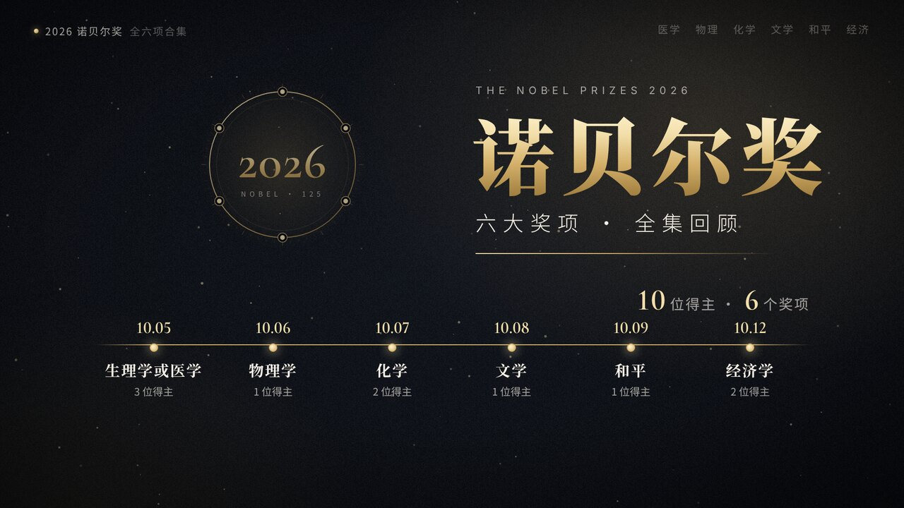
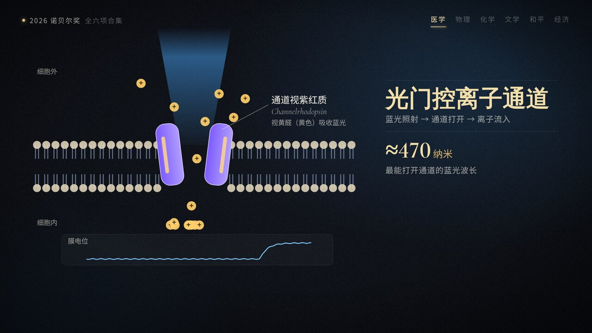
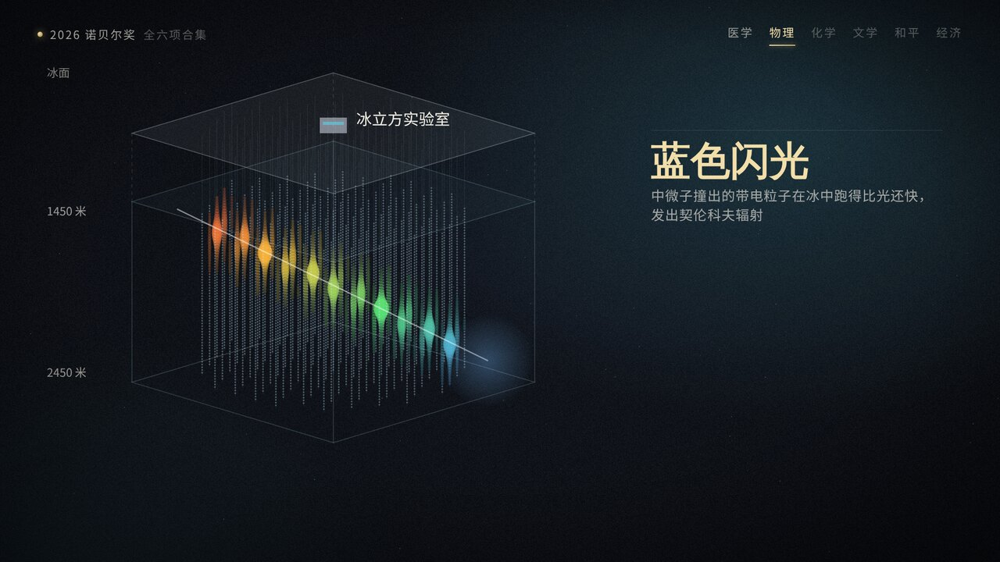
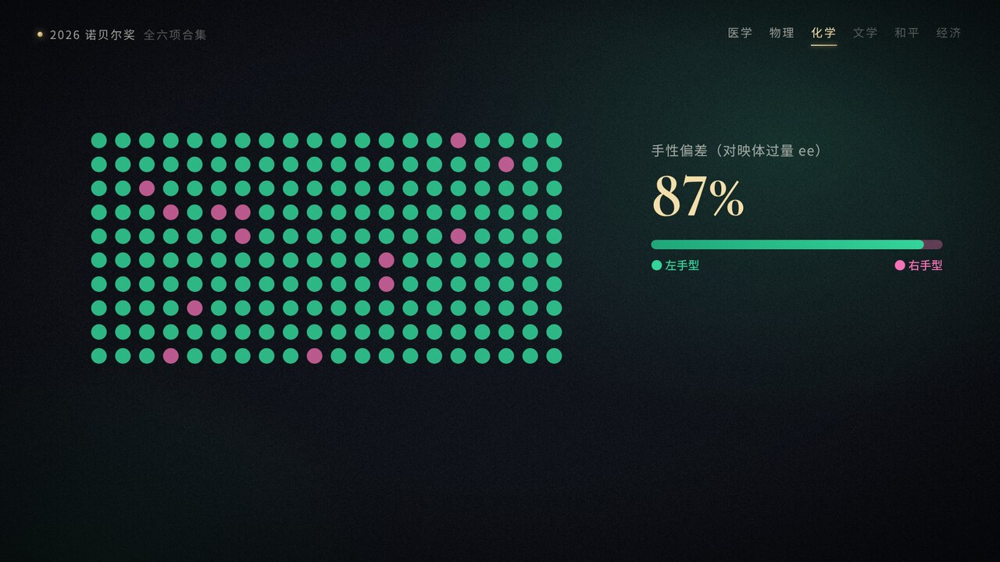
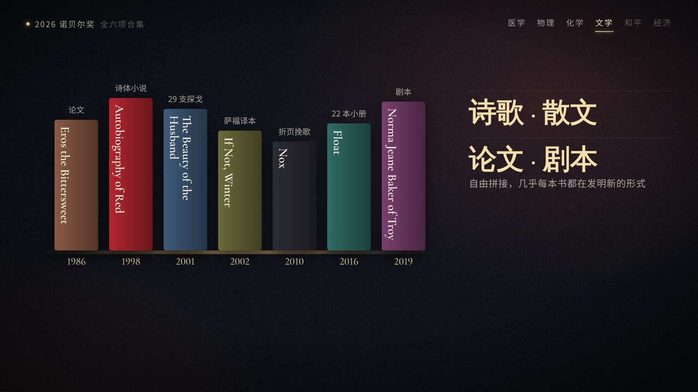
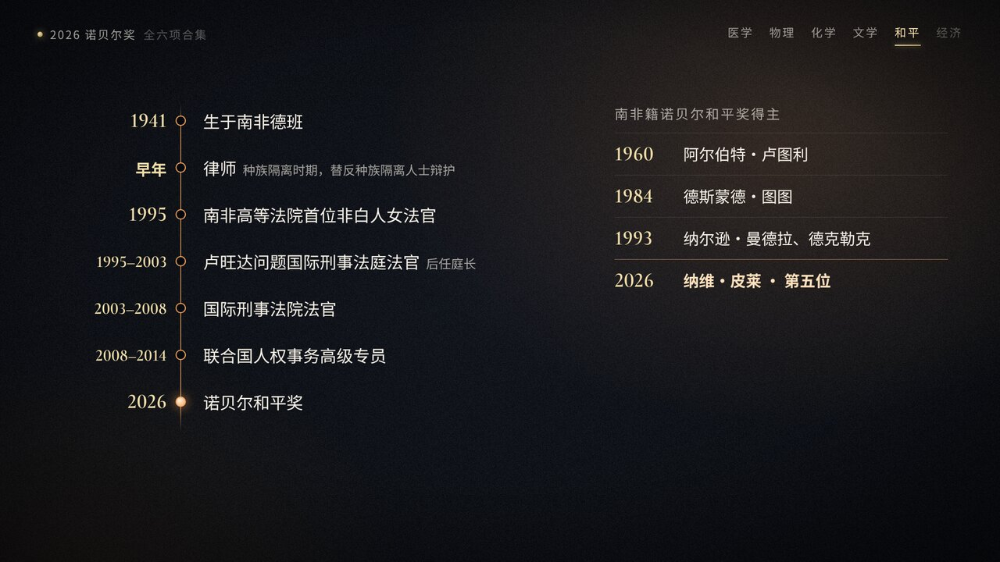
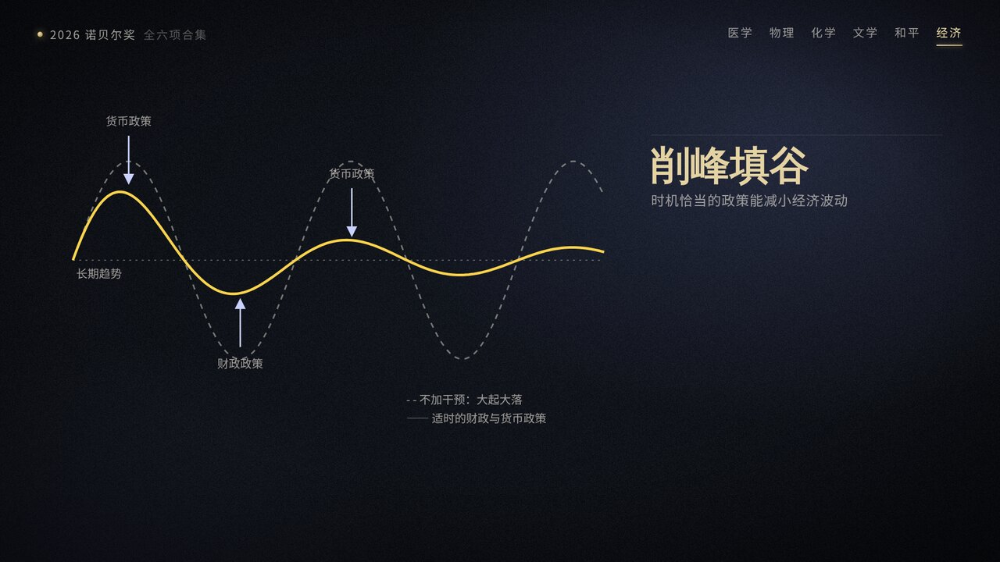

# 2026 诺贝尔奖全六项合集（视频版）

## 引言

2026 年诺贝尔奖六个奖项已在 10 月 5 日至 12 日间全部揭晓。今年恰逢诺贝尔奖首次颁发 125 周年，每个奖项的奖金也提高到了 1200 万瑞典克朗。

我做了一个约 7 分钟的视频合集，用动画把六个奖项讲了一遍：每个奖项都有得主信息、官方颁奖词，以及一段原理示意动画。下面是视频，后面附有文字版要点，方便快速浏览。

<video src="./videos/nobel-2026.mp4" poster="./images/nobel-2026/cover.jpg" controls width="100%"></video>

> 如果上方播放器没有显示，点击封面图即可打开视频（MP4，1080p，6 分 49 秒）。中文字幕已内嵌在画面中，另附字幕文件 [nobel-2026.srt](./videos/nobel-2026.srt)。

## 目录

- [生理学或医学奖：光遗传学](#生理学或医学奖光遗传学)
- [物理学奖：冰立方与高能中微子](#物理学奖冰立方与高能中微子)
- [化学奖：手性从何而来](#化学奖手性从何而来)
- [文学奖：安妮·卡森](#文学奖安妮卡森)
- [和平奖：纳维·皮莱](#和平奖纳维皮莱)
- [经济学奖：宏观稳定的微观基础](#经济学奖宏观稳定的微观基础)
- [资料来源与制作说明](#资料来源与制作说明)

## 生理学或医学奖：光遗传学

- **揭晓**：10 月 5 日，卡罗琳医学院诺贝尔大会
- **得主**（三人平分）：
	- 卡尔·戴塞罗思（Karl Deisseroth），美国斯坦福大学 / 霍华德·休斯医学研究所
	- 彼得·黑格曼（Peter Hegemann），德国柏林洪堡大学
	- 格奥尔格·内格尔（Georg Nagel），德国维尔茨堡大学
- **颁奖词**：表彰他们在光门控离子通道和光遗传学方面的发现（*for their discoveries concerning light-gated ion channels and optogenetics*）

黑格曼和内格尔在一种单细胞绿藻中发现了 **通道视紫红质**：这种膜蛋白被蓝光照射时会像门一样打开，让离子流入细胞，产生电信号。2005 年，戴塞罗思把编码它的基因导入神经元，用光脉冲就能以毫秒级精度让神经元放电，两年后又在活体小鼠大脑中实现了光控。

这就是 **光遗传学**。如今它是全球实验室研究记忆、感觉和行为的重要工具，也被用于抑郁症、阿尔茨海默病和疼痛等研究，甚至有团队尝试用它帮助部分视网膜疾病患者恢复视觉。

## 物理学奖：冰立方与高能中微子

- **揭晓**：10 月 6 日，瑞典皇家科学院
- **得主**（一人独得）：弗朗西斯·哈尔岑（Francis Halzen），比利时裔美国物理学家，美国威斯康星大学麦迪逊分校，冰立方中微子天文台首席研究员
- **颁奖词**：表彰他对冰立方中微子天文台的决定性贡献，以及发现了来自天体物理源的高能中微子（*for decisive contributions to the IceCube Neutrino Observatory and the discovery of high-energy neutrinos of astrophysical origin*）

中微子几乎不与任何物质发生作用，每秒都有数以万亿计的中微子穿过我们的身体，因此被称为“幽灵粒子”。早在 1988 年，哈尔岑就提出用南极冰层来捕捉它们。

最终建成的 **冰立方**，在南极冰面下 1450 米到 2450 米深处布设了 5160 个光学传感器，监视着约 1 立方公里的冰。偶尔有中微子撞上原子核，产生的带电粒子在冰中跑得比光还快，激发出微弱的蓝色契伦科夫辐射，被传感器记录下来。2013 年，冰立方首次捕捉到来自太阳系之外的高能中微子，为人类打开了观察宇宙的新窗口。

## 化学奖：手性从何而来

- **揭晓**：10 月 7 日，瑞典皇家科学院
- **得主**（两人平分）：
	- 亨利·卡甘（Henri B. Kagan），法国巴黎-萨克雷大学，95 岁
	- 硖合宪三（Kenso Soai），日本东京理科大学
- **颁奖词**：表彰他们发现了不对称有机合成中的非线性效应和自催化（*for the discovery of non-linear effects and autocatalysis in asymmetric organic synthesis*）

许多分子像左右手一样互为镜像、却无法重合，这叫 **手性**。生命偏偏只用其中一种：构成蛋白质的氨基酸几乎全是“左手型”。

- **非线性效应**（卡甘，1986 年）：催化剂的手性纯度和产物的手性纯度并不是简单的直线关系，微小的偏差可以被放大。
- **不对称自催化**（硖合宪三，1995 年，即“硖合反应”）：反应产物本身就是催化剂，会不断“复制”出同样手性的自己。起初只有 2% 的手性偏差，几轮反应之后就被放大到了 87%。

两人的发现为“单一手性如何自发出现”这个困扰化学界一百多年的谜题提供了一条化学途径，也对药物合成意义重大。95 岁的卡甘是诺贝尔化学奖历史上年龄第二大的得主（最年长的是 2019 年获奖时 97 岁的古迪纳夫）。

## 文学奖：安妮·卡森

- **揭晓**：10 月 8 日，瑞典学院
- **得主**：安妮·卡森（Anne Carson），加拿大诗人、古典学者、译者，76 岁
- **颁奖词**：表彰她大胆而富有创造力的作品，在与古典传统的嬉戏对话中，为当代文学创造了新的形式（*for her bold and inventive oeuvre that, in playful dialogue with the classical tradition, has created new forms for contemporary literature*）

卡森研究古希腊文学。翻译萨福残篇时（*If Not, Winter*，2002），她用方括号标出纸草上缺失的文字，让空白本身也成为诗的一部分。代表作《红的自传》（*Autobiography of Red*，1998）把古希腊神话中的有翼怪物格律翁改写成一部诗体小说。她的作品还包括 *Eros the Bittersweet*（1986）、*Nox*（2010）、*Float*（2016）、*Norma Jeane Baker of Troy*（2019）等，诗歌、散文、学术论文和剧本自由拼接，几乎每本书都在发明新的形式。瑞典学院联系上她时，卡森正在冰岛。

## 和平奖：纳维·皮莱

- **揭晓**：10 月 9 日，挪威诺贝尔委员会（奥斯陆）
- **得主**：纳瓦尼特姆·“纳维”·皮莱（Navanethem "Navi" Pillay），南非法学家，85 岁
- **颁奖词**：表彰她推动和平与国际法的努力（*for her efforts to promote peace and international law*）

种族隔离时期，皮莱以律师身份替反种族隔离人士辩护；1995 年成为南非高等法院首位非白人女法官，同年出任卢旺达问题国际刑事法庭法官（后任庭长）。挪威诺贝尔委员会特别指出，她推动确立了强奸和性暴力可以构成危害人类罪乃至种族灭绝罪。此后她还担任过国际刑事法院法官（2003—2008）和联合国人权事务高级专员（2008—2014）。

她是继卢图利（1960）、图图（1984）、曼德拉与德克勒克（1993）之后，第五位获得诺贝尔和平奖的南非人。

## 经济学奖：宏观稳定的微观基础

- **揭晓**：10 月 12 日，瑞典皇家科学院
- **得主**（两人平分）：
	- 罗伯特·霍尔（Robert E. Hall），美国斯坦福大学，1943 年生
	- 迈克尔·伍德福德（Michael Woodford），美国哥伦比亚大学，1955 年生
- **颁奖词**：表彰他们奠定了宏观经济稳定政策的微观经济基础（*for microeconomic foundations of macroeconomic stabilisation*）

上世纪 70 年代石油危机期间，高通胀与高失业同时出现，传统的凯恩斯主义模型突然不灵了。两人不再只依赖通胀、产出、消费等宏观变量之间的统计关系，而是从家庭和企业如何做决策出发搭建宏观经济模型。这些模型表明，时机恰当的财政和货币政策可以平抑经济的大起大落；如今全球许多央行和政府使用的模型，都建立在这一基础之上。

**12 月 10 日**，颁奖典礼将分别在斯德哥尔摩（和平奖除外的五个奖项）和奥斯陆（和平奖）举行。

## 资料来源与制作说明

资料来源：

- 诺贝尔奖官网新闻稿：[医学](https://www.nobelprize.org/prizes/medicine/2026/press-release/) · [物理](https://www.nobelprize.org/prizes/physics/2026/press-release/) · [化学](https://www.nobelprize.org/prizes/chemistry/2026/popular-information/) · [文学](https://www.nobelprize.org/prizes/literature/2026/press-release/) · [和平](https://www.nobelprize.org/prizes/peace/2026/press-release/) · [经济学](https://www.nobelprize.org/prizes/economic-sciences/2026/press-release/)
- 瑞典皇家科学院：[They solved chemistry's asymmetric mystery](https://www.kva.se/en/prizes/nobel-prizes/they-solved-chemistrys-asymmetric-mystery/)
- 新华网：[医学奖](https://www.news.cn/world/20261005/d99d6630d7e849d9a37575621a25e54d/c.html) · [化学奖](https://www.news.cn/world/20261007/bc45d43eab8b40adb042a6aa9da47007/c.html) · [经济学奖](https://www.news.cn/world/20261012/326c1c98ffe14c4b94a860414687b9f9/c.html)
- 威斯康星大学麦迪逊分校：[Francis Halzen named 2026 Nobel laureate in physics](https://news.wisc.edu/university-of-wisconsin-madison-professor-francis-halzen-named-2026-nobel-laureate-in-physics/)
- 联合国新闻：[前联合国人权高专皮莱获诺贝尔和平奖](https://news.un.org/zh/story/2026/10/1142968)
- 半岛电视台：[Canadian Anne Carson wins 2026 Nobel Prize in Literature](https://www.aljazeera.com/news/2026/10/8/canadian-anne-carson-wins-2026-nobel-prize-in-literature)

制作说明：

- 画面全部为原创示意动画（HTML / SVG / Canvas 绘制，逐帧渲染），未使用得主照片；图中曲线、数量等仅为示意。
- 旁白为 AI 语音合成（开源 Kokoro 模型），背景音乐为程序生成的原创配乐。
- 人名译法参考新华社等中文媒体，不同媒体译名可能略有差异。
